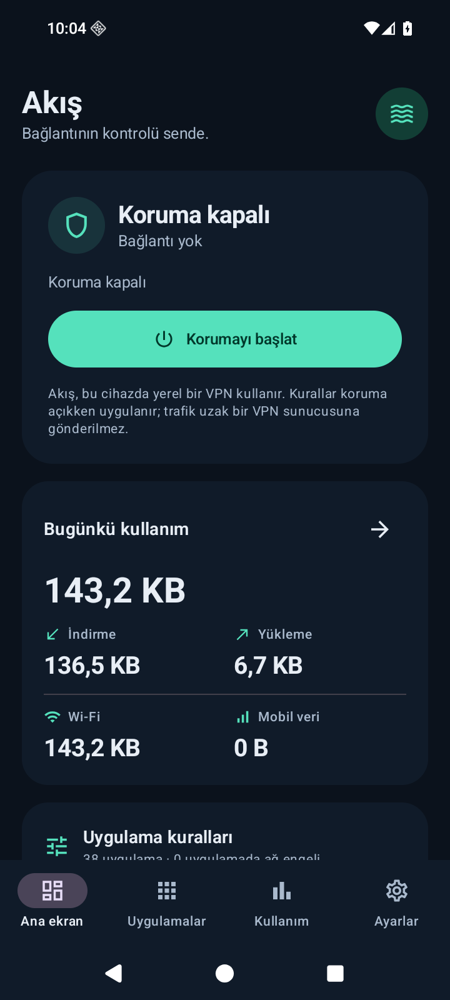

# Akış — Android bağlantı kontrolü

Akış, uygulamaların Wi-Fi ve mobil veri erişimini, hızını ve kotasını telefonda yöneten bir Android uygulamasıdır. Kotlin ve Jetpack Compose arayüzü, Android `VpnService` ve Go tabanlı yerel TCP/UDP motorunu kullanır. Root gerektirmez.

Oturumlar arasında devam etmek için önce [güncel devir kaydını](docs/HANDOFF.md),
[işlem günlüğünü](docs/WORK_LOG.md) ve [çalışma kurallarını](AGENTS.md) oku.
GitHub'daki son durumu kontrol etmeden eski sohbetin kaldığı yerden değişiklik uygulama.

**Geliştirme sürümü 0.1.4 / versionCode 5:** Kaynak kod, seçilen [Açık ve sade](docs/designs/01-acik-ve-sade.png) tasarımına göre mint renkli uygulama listesi ve tam ekran bağlantı düzenleyicisi içeriyor. Yeni kurulumlarda açık tema seçilir; mevcut kayıtlı tema tercihi ve Ayarlar'daki koyu tema seçeneği korunur. Wi-Fi/mobil sekmeleri, hız birimleri, günlük/haftalık/aylık kotalar ve gelişmiş ayarlar kullanılabilir; kaydedilmemiş düzenleme taslakları ekran yeniden oluşturulduğunda korunur. 60 JVM testi, lint ve debug/test APK derlemeleri geçti. Yeni arayüzün cihaz testi doğrulaması sürüyor; durum [docs/TESTING.md](docs/TESTING.md) içinde.

**Yayımlanmış 0.1.3 alfa:** Desteklenmeyen IPv6 yolunun tarayıcı bağlantısını sıfırlamasına yol açabilen hata düzeltildi; ağın DNS/rota değişiklikleri de izleniyor. 54 JVM testi, native TLS testleri ve Android 16/API 36 emülatöründe 6 cihaz testi geçti. Wi-Fi/mobil kural geçişi ve alan adıyla bağlantı sınandı. Android 10 ve üzerini hedefler; Samsung telefonda tekrar doğrulama bekleniyor. Bu bir debug test sürümüdür; Play Store yayınına hazır olarak sunulmaz. Bu sonuçlar yeni 0.1.4 arayüzünün cihaz testleri yerine geçmez.

## APK indir

[Akış 0.1.3 test APK'sını indir](https://raw.githubusercontent.com/ssad96291-png/uygulama-1/main/downloads/akis-0.1.3-debug.apk)

Bu bağlantı yayımlanmış **0.1.3** sürümüdür. Mint tasarımın 0.1.4 APK'sı henüz telefon güncellemesi olarak yayımlanmadı. Mevcut geliştirme ortamının debug imzası 0.1.3'ten farklıdır; yerel derleme mevcut telefon kurulumunun üzerine güncellenebilir diye sunulmaz.

Android 10 ve üzeri telefonda APK'yı kur. 0.1.2 ile aynı imzayı kullandığı için mevcut uygulamayı kaldırmadan güncelleyebilirsin. **Uygulamalar** ekranından kurallarını seç, ardından **Korumayı başlat** düğmesiyle Android VPN iznini onayla. Aynı Android profilinde başka bir VPN ile eşzamanlı çalışmaz.

[Dosya özeti](downloads/akis-0.1.3-debug.apk.sha256) · [Doğrulama kaydı](docs/validation/0.1.3/verification.json) · [Android test sonucu](docs/validation/0.1.3/android-instrumentation.txt)



Bu ekran görüntüsü önceki koyu arayüzü gösterir; 0.1.4 mint tasarımının son ekran kanıtı değildir.

## Mevcut özellikler

- Her uygulama için Wi-Fi ve mobil veride ayrı izin/engel.
- Her ağ için ayrı indirme ve yükleme hızı; KB/s, MB/s veya Mbps girişi ve sınırsız seçenek. Birimler ondalıktır: 1 KB/s = 1.000 bayt/s, 1 Mbps = 125.000 bayt/s.
- Uygulama başına günlük, haftalık veya aylık toplam indirme + yükleme kotası. Kota bitince engelleme veya seçilen düşük hıza geçme.
- Tüm uygulamalar için Wi-Fi ve mobil veride ayrı toplam kota. Bu kota dolunca ilgili ağdaki trafik engellenir.
- Aylık kota yenileme gününü 1–31 arasında seçme. Seçilen gün kısa bir ayda bulunmuyorsa o ayın son günü kullanılır. Haftalık kotalar pazartesi yenilenir.
- Bildirim izni açıkken %80, %95 ve %100 kota uyarıları.
- Arama, toplu kurallar, son toplu değişikliği geri alma ve 15 dakikalık geçici izin. Geçici izin uygulamanın erişim/hız/kota sınırlarını kaldırır; toplam kota geçerli kalır.
- Özel kuralı olmayan mevcut ve yeni uygulamalar için varsayılan Wi-Fi/mobil erişim tercihleri.
- Günlük, haftalık ve aylık kullanım görünümü, Wi-Fi/mobil filtresi ve CSV dışa aktarma.
- Dosyaya yedekleme ve geri yükleme; koyu/açık tema; sistem uygulamalarını ve ek filtreyi açan gelişmiş görünüm.
- Yerel bakım hesabı ve tanılama ekranı.

## Kullanım

1. Debug APK'yı test telefonuna kur ve Akış'ı aç. Uygulama Android 10/API 29 veya üstünü gerektirir.
2. **Uygulamalar** ekranında bir uygulamanın Wi-Fi ve mobil izinlerini, hızlarını ve kotalarını ayarla.
3. Ana ekrandan korumayı başlat ve Android'in VPN iznini onayla. Kota uyarıları için bildirim izni ver.
4. Küçük bir indirme ile izin/engel ve hız davranışını dene. Kurallar yalnızca koruma açıkken uygulanır.

**Ayarlar → Sürüm** satırına art arda yedi kez dokunmak bakım girişini açar. İlk kullanımda cihazda kullanıcı adı ve en az sekiz karakterli parola oluşturulur. Parola PBKDF2-HMAC-SHA256 ile saklanır; başarısız girişler beklemeye alınır. Ortak veya sabit bir yönetici parolası yoktur. Bu hesap o kurulumun yerel bakım hesabıdır; uygulama sahibine bütün telefonlarda uzaktan veya ayrıcalıklı erişim sağlamaz. Yönetici hesabı taşınabilir yedeğe dahil edilmez.

## VPN, ölçüm ve gizlilik

Android aynı kullanıcı/iş profili içinde aynı anda bir VPN hizmeti çalıştırır. Akış; Proton VPN, NordVPN, Avast VPN veya başka bir VPN uygulamasının üstüne ikinci VPN olarak eklenemez. Akış'ı başlatmak diğer VPN bağlantısının yerini alır. Uygulama bu durumu başlatmadan önce açıklar. Uzak VPN'e bağlantı veya uygulama içine WireGuard/OpenVPN entegrasyonu bu sürümde yoktur.

Akış'ın VPN'i yereldir: trafik telefonda denetlenir, ardından seçilen Wi-Fi veya mobil bağlantı üzerinden asıl hedefe gönderilir. Kendi sunucusu, hesap hizmeti, reklam SDK'sı, analitik veya ödeme sistemi yoktur. Bu yapı IP adresini gizlemez ve uzak bir VPN'in sağladığı tünel şifrelemesini eklemez. Uygulamaların kendi TLS/HTTPS trafiği şifresi çözülmeden taşınır; DNS istekleri alttaki ağın DNS sunucusuna iletilir.

Kurallar, kullanım toplamları ve bakım bilgileri uygulamanın özel depolamasında tutulur. Sistem yedeklemesi kapalıdır. CSV veya JSON yedeği yalnızca kullanıcı dışa aktardığında seçtiği belge konumuna yazılır; bulut belge sağlayıcısı seçilirse dosyanın aktarımı o sağlayıcıya bağlıdır. Yedek kuralları, tercihleri ve kullanım kayıtlarını içerir; içe aktarmak bunları değiştirir ve önce korumayı durdurmayı gerektirir.

Sayaçlar yalnızca Akış açıkken iletilen TCP/UDP uygulama verisini ölçer; ağ başlıklarını veya tekrar iletilen ağ paketlerini saymaz. Kurulumdan önceki Android kullanımını içe aktarmaz. Bu nedenle sonuçlar operatörün faturaladığı veri miktarıyla aynı olmak zorunda değildir. Kayıtlar bugünden 400 gün öncesine kadar tutulur. Kullanım raporlarının ayları takvim ayıdır; seçilen kota yenileme günü kota hesabına uygulanır.

Aynı Android UID'sini paylaşan paketler tek kuralla yönetilir. Android 13/API 33 ve üzerinde bir uygulamanın SDK sandbox trafiği, ana uygulamanın UID'sine eşlenir; ana uygulamanın kurallarını, kotasını ve kullanım sayacını paylaşır. Sahibi belirlenemeyen trafik engellenir. Mevcut motor IPv4/IPv6 TCP ve UDP içindir; Wi-Fi ve mobil veri dışındaki bağlantılar desteklenen ağ sayılmaz. Kural veya ağ değişikliğinde açık bağlantılar yeniden kurulmak zorunda kalabilir. Android hizmeti kapatırsa koruma durabilir; Android'in **Her zaman açık VPN** ve **VPN olmadan bağlantıları engelle** seçenekleri cihaz üzerinde ayrıca denenmelidir.

Akış'ın kendi UID'si, ağ motorunun çıkış bağlantıları için VPN kapsamından çıkarılır; Akış kendi trafiğine uygulama kuralı uygulamaz. Root kullanmayan bu yapı, telefonun hotspot/USB internet paylaşımına bağlı cihazların veya başka Android kullanıcı/iş profillerinin trafiğini yönetmez. Ham ICMP gibi TCP/UDP dışındaki protokoller için hız ve kota kontrolü sağlamaz.

## Derleme

Gerekli araçlar:

| Araç | Kullanılan sürüm |
| --- | --- |
| JDK | 21; `javac` dahil tam JDK |
| Go | 1.25.5 |
| Android SDK platformu | 36 |
| Android build tools | 36.0.0 |
| Android NDK | 28.2.13676358 |
| Gradle | Wrapper ile 8.13 |
| Android Gradle Plugin / Kotlin | 8.13.2 / 2.2.10 |

Linux üzerinde Bash, bir C derleyicisi ve Android SDK komut satırı araçları da gerekir. SDK lisanslarını SDK Manager ile kabul et. Gerekli SDK paketleri:

```sh
sdkmanager "platforms;android-36" "build-tools;36.0.0" "platform-tools" "ndk;28.2.13676358"
```

`JAVA_HOME` ve `ANDROID_HOME` değişkenlerini kurulumlarına yönlendir; Go'yu `PATH` içine ekle. `ANDROID_NDK_HOME` verilmezse betik SDK içindeki yukarıdaki NDK sürümünü kullanır. Ardından:

```sh
./tools/build-debug.sh
```

İsteğe bağlı, güvendiğin bir ortam dosyası açıkça belirtilebilir:

```sh
AKIS_ENV_FILE=/absolute/path/android-env.sh ./tools/build-debug.sh
```

Betik önce [engine/build.sh](engine/build.sh) ile sabitlenmiş Go bağımlılıklarını kullanarak motor testlerini ve AAR derlemesini yapar. Sonra Gradle üzerinden birim testlerini, Android lint kontrolünü ve debug APK derlemesini çalıştırır. Gradle dağıtımının SHA-256 değeri wrapper yapılandırmasında sabitlenmiştir. İlk derleme bağımlılıkları indirmek için internet gerektirir; çalışma zamanında kendi sunucumuz gerekmez.

Çıktı: `app/build/outputs/apk/debug/app-debug.apk`. Paket adı `dev.akiskontrol.app`; geliştirme sürümü `0.1.4`, versionCode `5`. APK `arm64-v8a`, `armeabi-v7a` ve `x86_64` içerir. `app/libs/engine.aar` üretilen bir dosyadır ve depoya alınmaz; temiz kopyada önce motor derlenmelidir. Debug imzası geliştirme amaçlıdır; mevcut telefon kurulumuna güncelleme için önceki imzalama anahtarı gerekir. Dağıtım imzası ve Play App Signing ayrıca hazırlanmalıdır.

## Proje ve yayın hazırlığı

| Dizin | Amaç |
| --- | --- |
| `app` | Android arayüzü, VPN hizmeti, yerel kayıt ve cihaz testi |
| `core` | Android'den bağımsız hız/kota/erişim kuralları ve testleri |
| `engine` | Go/gVisor TCP/UDP motoru, yerel testler ve lisans metinleri |
| `probe` | Ayrı UID ile gerçek ağ trafiği üreten test uygulaması |
| `tools` | Derleme ve emülatör test yardım araçları |

`QUERY_ALL_PACKAGES`, başlatıcı simgesi olmayan internet kullanan uygulamaları da listelemek için kullanılır. Bu izin, `VpnService` kullanımı ve `specialUse` ön plan hizmeti için Play Console beyanları ve politika değerlendirmesi gerekir. Manifest'teki dar lint istisnası bu işlevsel gerekçeyi belgeler; Play onayı anlamına gelmez. Yayından önce gizlilik politikası, Data safety beyanı, mağaza içeriği, dağıtım imzası ve gerçek cihaz testleri tamamlanmalıdır.

Reklamlar ve ücretli üyelik henüz eklenmedi. Bağımlılık bildirimleri ve lisansları [engine/THIRD_PARTY_NOTICES.md](engine/THIRD_PARTY_NOTICES.md) ve `engine/licenses/` altında bulunur; motor lisans metinleri APK'ya varlık dosyaları olarak dahil edilir.
