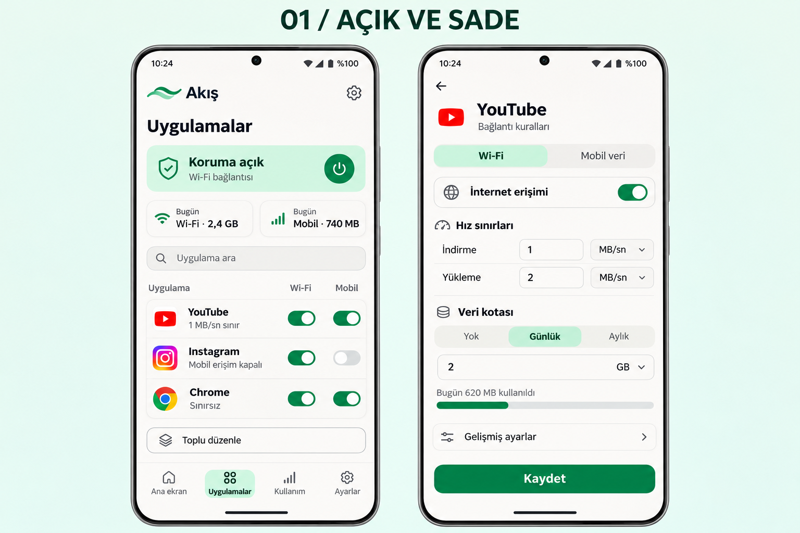

# 10 Kasım 2026 — bu oturumun kurulum ve tasarıma devam yazışmaları

Bu dosya, ayrı Codex oturumundan gelen [2026-11-10.md](2026-11-10.md) kaydını
değiştirmeden, bu oturumda erişilebilen kullanıcı ve asistan doğal dil mesajlarını
sırasıyla saklar. Mesajların ayrı ayrı kesin saatleri görünmediği için saat
uydurulmadı. Başlıklar arşiv açıklamasıdır; mesaj metinleri aşağıda korunmuştur.

Otomatik ortam/sayfa meta verileri, yapılandırılmış beceri metni, araç çağrıları
ve sonuçları, sistem/geliştirici talimatları ve iç muhakeme bu sohbet dökümüne
dahil değildir. Seçilen depo `ssad96291-png/uygulama-1`, başlangıç referansı
`main` idi. Başka oturumların erişilmeyen mesajları burada varmış gibi sunulmaz.

Özellikle iki kaydın kurulum sonuçları birleştirilmemelidir: bu oturumda kalıcı
ortam taslağının kaydı `INVALID_ARGUMENT` nedeniyle doğrulanamadı. Diğer oturumun
kendi kaydındaki sonuç, bu oturumun aynı sonucu aldığı anlamına gelmez.

## 1 — Kullanıcı

Bu bulut ortamının kurulumunu yapmak için $cloud-environment-onboarding:setup kullan.

## 2 — Kullanıcı

devam

## 3 — Asistan

`cloud-environment-onboarding:setup` becerisini kullanarak kuruluma devam ediyorum. Depoyu inceleyip gerekli araçları kuracağım, uygulamanın çalışmasını doğrulayacağım ve yeniden kullanılabilir ortam ayarlarını hazırlayacağım.

## 4 — Asistan

Depo, Kotlin ve Go kullanan bir Android uygulaması. Kurulum doğrulaması için yerel motor testlerini, JVM testlerini, Android lint kontrolünü ve APK derlemesini çalıştıracağım; emülatör testleri ek kontrol olacak. Bu makinede Android SDK ve tam JDK eksik. Ortam ayarlarını okuyan araç da hata veriyor; araç kurulumu ve testlere devam ediyorum.

## 5 — Asistan

GitHub’daki `main` dalı ile yerel depo aynı sürümde; Git erişimi çalışıyor. Go 1.25.5 kuruldu ve motor testleri başladı. Android araçlarının indirmelerini doğruluyorum. Bu makinede donanım hızlandırması olmadığı için emülatör testleri yazılım emülasyonu gerektirecek.

## 6 — Asistan

Go motorunun 16 ana testi ve 19 alt testi geçti. JDK 21 de kuruldu; Java’nın ortamın güvenli ağ bağlantısını kullanabildiğini doğruladım. Android SDK Manager’ın ilk hatası yazılamayan önbellek dizininden kaynaklanıyordu; önbelleği çalışma alanına taşıdıktan sonra paket kurulumu ilerledi.

## 7 — Asistan

Android SDK 36, build tools 36.0.0 ve NDK 28.2 kuruldu; Gradle 8.13 de çalışıyor. Şimdi üç işlemci mimarisi için motoru ve APK’yı derliyorum. Ayrıca uygulamanın açılışını sınamak için ayrı bir yazılım emülatörü hazırlıyorum.

## 8 — Asistan

İlk motor derlemesi, geçici derleme dizininde Git sürüm bilgisinin okunamaması nedeniyle durdu. Go’nun bu bilgiyi APK’ya eklemesini ortam ayarıyla kapattım ve derlemeyi yeniden başlattım. Uygulama kaynaklarında değişiklik gerekmedi.

## 9 — Asistan

Üç mimarili yerel motor derlemesi tamamlandı. Gradle şimdi uygulama bağımlılıklarını indirip JVM testleri ve Android derlemesine geçiyor. Tekrarlanabilir kurulum betiği de hazır; mevcut derleme bittikten sonra betiği çalıştırarak doğrulayacağım.

## 10 — Asistan

JVM testleri çalışmaya başladı ve tamamlanan testler geçiyor. Android 36 emülatörü de açıldı; uygulama paketleri hazır olduğunda açılışını ve üç mevcut veri/yedek testini sınayacağım.

## 11 — Asistan

Çekirdek modüldeki 44 JVM testi geçti. İlk APK derlemesi sürüyor; Compose bağımlılıklarının işlenmesi ve yazılım emülatörünün ilk açılışı zaman alıyor. Depodaki dosyalar hâlâ değişmeden duruyor.

## 12 — Kullanıcı

devam

## 13 — Asistan

Devam ediyorum. APK derlemesi, lint kontrolü ve 54 JVM testinin tamamı geçti. Kurulum betiğini şimdi yeniden çalıştırarak doğruluyorum; emülatör açılışını tamamlayınca üç Android veri/yedek testi çalışacak.

## 14 — Asistan

Kurulum betiğinin tamamı yeniden çalıştırıldı ve başarılı oldu; uygulama, test APK’ları ve emülatör ayarları tekrar kullanılabiliyor. Şimdi kurulum ve başlatma talimatlarını ortam yapılandırmasına kaydediyorum. Emülatördeki son çalışma kontrolü sürüyor.

## 15 — Asistan

Ortam yapılandırma hizmeti kaydetme sırasında `INVALID_ARGUMENT` hatası verdi; ardından taslağı okuma denemesi de başarısız oldu. Bu nedenle ayarların kalıcı olarak kaydedildiğini doğrulayamıyorum. Test edilmiş talimatlar çalışma alanında duruyor; son Android kontrolünü tamamlıyorum.

## 16 — Asistan

Emülatör açılışını tamamladı; donanım hızlandırması olmadığı için ilk açılış yaklaşık 12 dakika sürdü. Başlatma talimatındaki bekleme süresini buna göre düzelttim. Şimdi uygulamayı yükleyip son üç cihaz testini çalıştırıyorum.

## 17 — Asistan

Emülatörde Android’in başlatıcısı yanıt vermiyor uyarısı çıktı; bu, yazılım emülasyonunun yavaşlığıyla ilgili görünüyor. Depodaki test belgesinde bu durum için belirtilen emülatör zaman aşımı ayarını uygulayıp cihaz testlerini yeniden çalıştıracağım. Derleme ve 54 JVM testi zaten başarılı.

## 18 — Asistan

Üç Android veri/yedek testi de geçti. Son kontrolde GitHub’daki `main` dalına başka bir oturumdan yeni arayüz değişiklikleri geldiğini gördüm; buradaki sonuçlar başlangıçtaki `dc0ff63` sürümüne ait. Emülatörün zaman aşımı ayarından sonraki açılış kontrolünü tamamlayıp bu ayrımı kurulum raporuna ekliyorum.

## 19 — Asistan

Android, yeni zaman aşımı ayarıyla yeniden başladı. Son uygulama açılışını kontrol ediyorum. Kalıcı ayar kaydı için gereken iki alanı ve test kanıtlarını yerel dosyalarda hazırladım; yapılandırma hizmetindeki hata hâlâ kaydı doğrulamamı engelliyor.

## 20 — Asistan

Uygulama emülatörde başarıyla açıldı; ana ekran ve “Korumayı başlat” düğmesi doğrulandı. APK derlemesi, lint, 54 JVM testi, Go motor testleri ve üç Android veri/yedek testi tamamlandı. Kalan engel, kurulum ayarlarının platformdaki kalıcı kaydının doğrulanamaması.

## 21 — Asistan: kurulum sonucu

Makine kurulumu doğrulandı: APK derlemesi, lint, 54 JVM testi, Go motor testleri ve 3 Android testi geçti. Uygulama emülatörde açıldı.

**Kalıcı ayar kaydı**, platformun `INVALID_ARGUMENT` hatası nedeniyle doğrulanamadı. Ortam ayarlarına kaydedilecek dosyalar hazır:

- `install_script`: [Kurulum betiği](/workspace/toolchains/install-environment.sh)
- `start_skill`: [Başlatma talimatları](/workspace/toolchains/START.md)

Testler `dc0ff63` sürümüne ait; sonradan gelen `main` değişikliklerini kapsamıyor. [Ayrıntılı sonuçlar](/workspace/toolchains/RESULTS.md).

## 22 — Kullanıcı: anında kayıt ve uygulama tasarımı

bu projeye ne yaparsan hangi işlemi uygularsan yaptıgın anda github a ekle en son eklemeye balkma çünki bu projeyi 2 farklı codex ile devam ettiriyorum ayrıca projeye devam et dersem ilk önce en son ne yapıldıgına bakıp devam etmen olucak sohbette görsel olarak ne gönderirsek gönderirsen eklemeni istiyprum ayrıca ne yazdıysak benimkileri dahil şimdi baba uygulama tasarımını bu hale getirmen

## 23 — Asistan

Önce GitHub’daki en son değişiklikleri ve devir kaydını okuyacağım. Tamamladığım her anlamlı değişikliği bekletmeden commit edip GitHub’a göndereceğim; erişebildiğim konuşmaları ve görselleri de kaydedeceğim. Tasarım işine güncel kayıtta belirtilen hedef üzerinden devam edeceğim.

## Bu oturumda erişilebilen görsel kaynağı

Son kullanıcı mesajıyla birlikte bu oturumda okunabilir yeni bir görsel eki
bulunmuyor. Uzak devir kaydı ve diğer oturumun konuşma arşivi, seçilmiş hedefin
**01 / AÇIK VE SADE** olduğunu belirtiyor. Bu oturumda tasarım incelemesi için
depodaki aşağıdaki mevcut dosya açıldı; yeni bir özgün yüklemenin byte düzeyinde
kopyalandığı iddia edilmiyor.

- Dosya: [01-acik-ve-sade.png](../designs/01-acik-ve-sade.png)
- Kaynak kayıt: [diğer oturumun tasarım seçimi](2026-11-10.md#23--kullanıcı-kayıt-ilkesi-ve-tasarım-seçimi)
- Önceden kaydedilmiş SHA-256: `96e07d6d0e914956b490cde8901421d56acbc726e06b76107cfc5af6345736cf`

Bu oturumun yukarıdaki kurulum aşamasında yeni PNG ekran görüntüsü veya üretilmiş
tasarım görseli gönderilmedi. Arayüz kontrolleri yerel UI hiyerarşisi dosyalarıyla
yapıldı. Diğer oturumun önceki ekran görüntüleri kendi
[görsel arşivinde](media/2026-11-10-onboarding/README.md) ayrı kaynak olarak
korunmaktadır.

## 24 — Asistan

GitHub’daki kayıtta hedefin **“01 / Açık ve sade” mint tasarımı** olduğunu gördüm. Diğer Codex uygulama listesini ve tam ekran kural düzenleyicisini hazırlamış; 60 JVM testi geçmiş, cihazdaki düzenleme testi henüz tamamlanmamış. Bu değişiklikleri aldım ve kalan arayüz doğrulamasından devam ediyorum.

## 25 — Asistan

Konuşma arşivini ve tasarım referansını GitHub’a ayrı bir kayıt olarak gönderdim. Yeni arayüzün derlemesi de bu makinede geçti. İncelemede, kural düzenleyicisinden dönünce aramanın ve liste konumunun kaybolduğunu buldum; şimdi bunu düzeltiyorum.

## 26 — Kullanıcı

devam

## 27 — Asistan

Devam ediyorum. Önce diğer Codex’in yeni kayıtlarını kontrol edeceğim; ardından arama ve liste konumunu koruyan düzeltmeyi tamamlayıp mint tasarımın cihaz testlerini çalıştıracağım.

## 28 — Asistan

Diğer Codex de arama durumunu koruyan düzeltmeyi ve cihaz testindeki iki seçici sorununu çözmüş; onun güncel kodunu aldım. Ayrıca klavye açıldığında formun daralmaması için uygulama başlığını kaydırılabilir alana taşıdım. Bu değişikliği hemen kaydedip birleşik sürümü sınayacağım.

## 29 — Asistan

Birleşik sürümün derlemesi, lint kontrolü ve 60 JVM testi geçti. Bu sonucu da GitHub’a kaydediyorum. Şimdi gerçek ekranda iki ağın ayrı değerlerini, kaydetme/iptal davranışını ve ekran yeniden oluşturulduğunda taslakların korunmasını sınayacağım.

## 30 — Asistan

Güncel uygulama ve test paketleri emülatöre yüklendi; dört cihaz testi çalışıyor. Tamamlanan değişikliklerin tümü GitHub’da. Test sonucu çıktıktan sonra açık tema ekranlarını ve dar ekranda düzenleme görünümünü kontrol edip görselleri de ekleyeceğim.

## 31 — Asistan

Üç veri/yedek testi geçti; arayüz testi mobil erişim anahtarının beklenen etiketini bulamadığı için durdu. Ekranda mobil sekmesi ve doğru başlangıç değerleri görünüyor. Hata kaydını ve ekran görüntüsünü GitHub’a ekleyip bunun test seçicisinden mi, arayüzden mi kaynaklandığını inceliyorum.

Test sırasında incelenen görsel: [mobil sekmesi seçici tanısı](../validation/0.1.4-ui/second-session-mobile-selector.png). Bu görüntü tamamlanmış açık tema tasarımının teslim ekranı değildir.

## 32 — Asistan

Erişilebilirlik ağacında mobil anahtarın etiketi hem açık hem kapalı durumda doğru görünüyor. Teste, alan düzenlemesinden sonra klavyeyi kapatıp ağ kontrollerini görünür alana getiren bir adım ekleyeceğim; kaydetme ve veri koruma kontrolleri aynı kalacak. Ayrıca 360 dp genişlikteki telefonlarda satırların referanstaki gibi yan yana görünmesi için yerleşim eşiğini düzeltiyorum.
