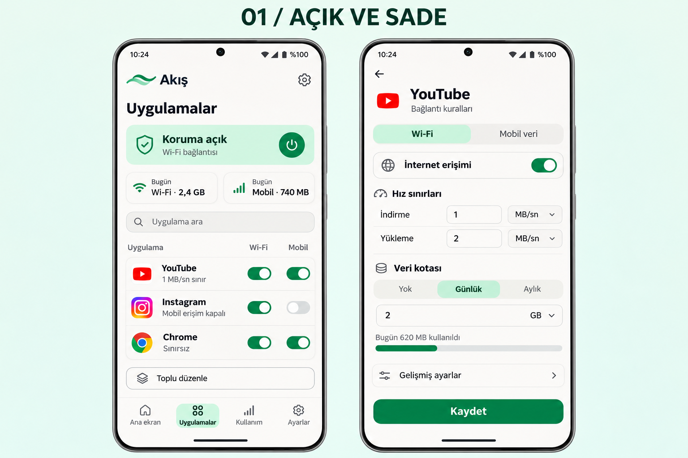

# 10 Kasım 2026 — görünür yazışma kaydı

Bu kayıt, bu göreve aktarılan konuşmada erişilebilen kullanıcı ve asistanın doğal
dil mesajlarını sırasıyla içerir. Mesajların ayrı gönderim saatleri kaynakta
bulunmadığından saat eklenmemiştir. Önceki farklı Codex oturumlarının tam dökümü
değildir. İşlem komutları ve sonuçları için [işlem günlüğüne](../WORK_LOG.md) bak.

## 01 — Kullanıcı: ortam kurulum isteği

```json
{"repositories":[{"name":"ssad96291-png/uygulama-1","ref":"main"}]}
```

> Bu bulut ortamının kurulumunu yapmak için $cloud-environment-onboarding:setup kullan.

Kullanıcı ayrıca `cloud-environment-onboarding:setup` becerisini yapılandırılmış
bir ek olarak iletti. Beceri tanımı, görünür sohbet cümlesinden ayrı bir kaynak
belgedir. Ortam bağlamı ve Page seçimi gibi makine meta verileri bu döküme dahil
edilmedi.

## 02 — Asistan: kurulum başlangıcı

Bulut ortamını hazırlamak için `cloud-environment-onboarding:setup` becerisini kullanıyorum. Ortam hazır olduğunda depoyu inceleyip bağımlılıkları kuracağım, uygulamayı çalıştırarak doğrulayacağım ve tekrar kullanılabilir kurulum ayarlarını kaydedeceğim.

## 03 — Asistan: doğrulama kapsamı

Depo, Kotlin ve Go kullanan bir Android uygulaması. Temel kurulum doğrulaması; motor testleri, JVM testleri, Android lint ve debug APK derlemesini kapsayacak. Emülatör desteğini de kontrol edeceğim; fiziksel telefon testleri ayrı kalacak. Araç ve ağ kurulumu için `cloud-environment-runtime` becerisini de kullanıyorum.

## 04 — Asistan: araç eksikleri

GitHub’daki `main` ile yerel kopya aynı durumda. Bu makinede Java çalıştırıcısı var, ancak JDK derleyicisi, Go 1.25.5 ve Android SDK/NDK eksik. Araçları resmî kaynaklardan, dosya özetlerini doğrulayarak `/workspace/toolchains` altına kuruyorum. Bu ortamda üretilecek APK’nın debug imzasını da mevcut yayımlanmış APK ile karşılaştıracağım.

## 05 — Asistan: araç kurulumu ilerlemesi

JDK 21 ve Go 1.25.5 kuruldu; Android SDK ve NDK indiriliyor. GitHub erişimi mevcut kimlik doğrulamasıyla çalışıyor, ek erişim anahtarı gerekmiyor. Makinede donanımlı emülatör hızlandırması bulunmadığından cihaz doğrulaması için yazılım emülatörünü deneyeceğim.

## 06 — Asistan: Java proxy düzeltmesi

SDK ve NDK kurulumu tamamlandı, Go bağımlılıklarının doğrulaması geçti. İlk derleme denemesinde Java proxy ayarının sürüm kontrolüne ek çıktı yazdığını gördüm. Proxy ayarını araçların desteklediği başlatma seçeneğine taşıyarak kurulum betiğini düzeltiyorum.

## 07 — Asistan: Go testleri

Go motorunun race detector ile çalışan testleri geçti. Şimdi üç Android işlemci mimarisi için AAR üretiliyor; ardından JVM testleri, lint ve APK derlemesi çalışacak. Android 36 emülatör imajı da indiriliyor.

## 08 — Asistan: ADB dizini

Emülatör ve Android 36 imajı kuruldu. ADB, anahtar dosyalarını yazmaya kapalı kullanıcı dizininde oluşturmaya çalıştı; Android araçlarının kullanıcı verisi yolunu yazılabilir çalışma alanına yönlendiriyorum. Native Android derlemesi devam ediyor.

## 09 — Asistan: derleme ayarı ve emülatör

ADB erişimi düzeldi. Go’nun geçici derleme dizininde Git sürüm bilgisi toplamaya çalışması da AAR üretimini durdurmuştu; bunu derleme seçeneğiyle giderip yeniden başlattım. Emülatörü açılışı hızlandırmak için daha düşük ekran çözünürlüğüyle başlattım.

## 10 — Asistan: AAR ve Gradle

Üç mimariyi içeren AAR üretildi ve Gradle 8.13 doğrulanarak kuruldu. Kotlin ve Android bağımlılıkları hazırlanıyor. Kurulum betiğine araç yollarını, proxy/TLS ayarlarını ve emülatör hazırlığını ekledim; son kontrollerden sonra ortam taslağına kaydedeceğim.

## 11 — Asistan: test sunucuları ve emülatör kilidi

Yerel HTTP, UDP ve DNS test sunucuları beklenen yanıtları veriyor. Kotlin derlemesi tamamlandı. Emülatörün kapanan denemesinden kalan kilit dosyası yeniden açılışı engelledi; yalnızca bu oturumun test cihazına ait kilidi temizleyip kalıcı bir komut oturumunda yeniden başlatıyorum.

## 12 — Asistan: JVM testleri

54 JVM testi geçti: 44 çekirdek testi ve 10 uygulama testi, hata veya atlanan test yok. Lint ve APK paketleme sürüyor. Emülatör bu kez kalıcı oturumda çalışıyor; Android’in açılışı tamamlanınca uygulamayı kurup cihaz içindeki testleri çalıştıracağım.

## 13 — Asistan: APK ve imza kontrolü

Debug APK derlemesi ve lint tamamlandı; lint hatası yok. APK, beklenen sürümü ve üç işlemci mimarisini içeriyor, 16 KB ZIP hizalama kontrolü de geçti. Yeni ortamın debug imzası yayımlanmış APK’dan farklı; bu dosya yerel geliştirme ve emülatör testleri için kullanılacak. Kurulum betiğinin son hâlini tekrar çalıştırarak doğruluyorum.

## 14 — Kullanıcı

> devam

## 15 — Asistan: devam başlangıcı

Devam ediyorum. Derleme, 54 JVM testi ve lint kontrolü geçti. Şimdi son kurulum denemesinin sonucunu ve emülatörün durumunu kontrol edip, doğrulanan kurulum ve başlatma talimatlarını ortam taslağına kaydedeceğim.

## 16 — Asistan: kurulumun tekrarlanması

Kurulum betiğinin tekrar çalıştırılması da başarılı oldu. Android 36 emülatörü hazır; ana uygulama, trafik test uygulaması ve test APK’sı kuruldu. Uygulamanın açılışını ve üç Android JSON testini doğruluyorum; depo dosyalarında değişiklik yok.

## 17 — Asistan: Android testleri ve taslak kaydı

Android emülatöründeki üç test de geçti. Doğrulanan kurulum betiğini ve sonraki oturumlar için araçları, emülatörü ve test sunucularını başlatma talimatlarını şimdi ortam taslağına kaydediyorum.

## 18 — Asistan: System UI zaman aşımı

Uygulama ekranı açıldı, ancak yazılım emülatöründe Android’in System UI süreci zaman aşımına uğradı. Depoda bu durum için belgelenen emülatör bekleme ayarını uygulayıp arayüzü tekrar kontrol ediyorum; geçen test sonuçları korunuyor.

## 19 — Asistan: emülatör bekleme ayarı

Emülatörün sistem bekleme çarpanını belgede belirtildiği gibi 10 yaptım ve Android arayüzünü yeniden başlattım. Sistem bileşenleri çalışıyor; açılışın tamamlanmasını bekliyorum. Bu ayarı da sonraki oturumların başlatma talimatlarına ekledim.

## 20 — Asistan: son ekran kontrolü

Kurulum ve başlatma talimatları taslağa kaydedildi. Son kontrol, emülatörün yeniden açılıştan sonra uygulama ekranını sistem uyarısı olmadan gösterebilmesi; derleme ve test doğrulamaları tamamlandı.

## 21 — Asistan: başarılı uygulama açılışı

Emülatör ayarı işe yaradı: uygulama açılışı artık `Status: ok` sonucu veriyor. Yazılım emülasyonunda ilk açılış yaklaşık 64 saniye sürdü. Son ekran kontrolünü ve doğrulama kaydını tamamlıyorum.

## 22 — Asistan: kurulum sonucu

Bulut ortamının kurulumu tamamlandı.

- 16 Go testi, 54 JVM testi ve 3 Android JSON testi geçti.
- Debug APK derlendi; lint hatası yok.
- Android 36 emülatöründe uygulama açılışı ve ekran geçişi doğrulandı.
- `install_script` ve `start_skill` taslağa kaydedildi. Depo dosyaları değişmedi.

[Doğrulama raporu](/workspace/toolchains/logs/verification.json)

Fiziksel telefon testleri yapılmadı; yeni debug APK’nın imzası mevcut dağıtımdan farklı.

Ortam ayarlarında taslağı gözden geçirip kaydedin, ardından **Yayınla** seçeneğini kullanın. Yayınlama henüz yapılmadı.

## 23 — Kullanıcı: kayıt ilkesi ve tasarım seçimi

Kullanıcının belirttiği ek adı: `ChatGPT Görseli 10 Kas 2026 00_07_10.png`.
Kullanıcının verdiği yerel dosya yolu:
`C:/Users/kirig_acmpgt7/Downloads/ChatGPT Görseli 10 Kas 2026 00_07_10.png`.
Bu yol, dosyanın bulut makinesinde aynı yoldan okunabildiği anlamına gelmez.

> bu projeye ne yaparsan hangi işlemi uygularsan yaptıgın anda github a ekle en son eklemeye balkma çünki bu projeyi 2 farklı codex ile devam ettiriyorum ayrıca projeye devam et dersem ilk önce en son ne yapıldıgına bakıp devam etmen olucak sohbette görsel olarak ne gönderirsek gönderirsen eklemeni istiyprum ayrıca ne yazdıysak benimkileri dahil şimdi baba uygulama tasarımını bu hale getirmen

Ekli görselin üst başlığı: **01 / AÇIK VE SADE**. Görsel, açık zeminli ve mint
yeşili vurgulu uygulama listesini ve uygulamaya özel bağlantı kuralları ekranını
gösterir. Depoda önceden saklanan ilgili tasarım:
[01-acik-ve-sade.png](../designs/01-acik-ve-sade.png).
Yeni yüklemenin özgün dosya baytları ile bu dosya arasında bir karşılaştırma bu
kayıt hazırlanırken yapılmadı; aynı dosya özeti olduğu iddia edilmiyor.



## 24 — Asistan: tasarım uygulaması başlangıcı

Uygulamayı gönderdiğin açık mint tasarıma göre düzenleyeceğim. Önce GitHub’daki son durumu ve devir kayıtlarını kontrol edeceğim; ardından isteğini, tasarım görselini ve her tamamlanan değişikliği küçük kayıtlar hâlinde GitHub’a işleyeceğim. “Devam et” dediğinde de önce bu kayıtları okuyarak ilerleyeceğim.

## Görsel kayıt notları

Yukarıdaki kullanıcı tasarım eki dışında, ortam kurulumu sırasında emülatör
kontrolü için ekran görüntüleri araç üzerinden incelendi. Bunlar yeni tasarımın
uygulandığını göstermez; tasarım değişikliğinden **önceki** uygulamayı gösterir.
Çalışma alanındaki mevcut dosyalar:

- `/workspace/toolchains/logs/emulator-app.png`: System UI zaman aşımı penceresi görülen önceki ekran.
- `/workspace/toolchains/logs/emulator-app-after-tuning.png`: bekleme ayarı sonrası önceki ana ekran.
- `/workspace/toolchains/logs/emulator-apps-tab.png`: önceki uygulama listesi ekranı.

Bu üç dosyanın bu kayıt yazılırken yalnızca çalışma alanı konumları biliniyor;
burada dosyaların GitHub'a eklendiği veya değişmeyen özgün baytları koruduğu iddia
edilmiyor. Görsel arşive kopyalandıklarında kalıcı depo bağlantıları ve özetleri
eklenmelidir. Aynı yola daha sonra yeniden yazılan ara ekran görüntüleri ayrıca
korunmamışsa geriye dönük olarak varmış gibi sunulmaz.

### Asistan — tasarım uygulaması ilerleme kaydı

> Tasarım seçimini ve “her işlemden sonra GitHub’a kaydet, devam ederken önce son kaydı oku” kuralını ilk commit’e ekledim. Gönderdiğin görsel depodaki “Açık ve sade” referansıyla eşleşiyor. Uygulama listesini ve kural düzenleyicisini bu görsele göre hazırlarken mevcut hız, kota ve toplu işlem işlevlerini koruyorum.

Kurulum görüntüleri artık [media/2026-11-10-onboarding](media/2026-11-10-onboarding/README.md) altında dosya özetleriyle kayıtlıdır.

### Kullanıcı

> devam

### Asistan

> Devam ediyorum. Önce GitHub’daki son kayıtları kontrol edip diğer Codex oturumunun yaptığı değişiklikler varsa onları koruyacağım; ardından açık mint tasarımın kalan ekranlarını tamamlayıp test edeceğim.
