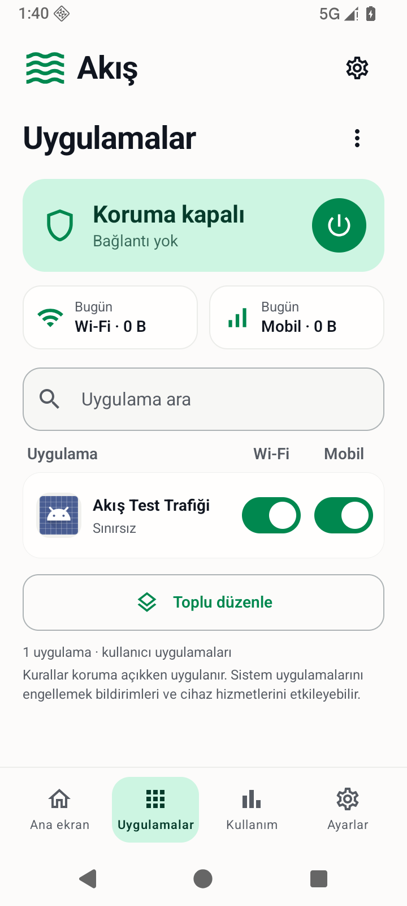
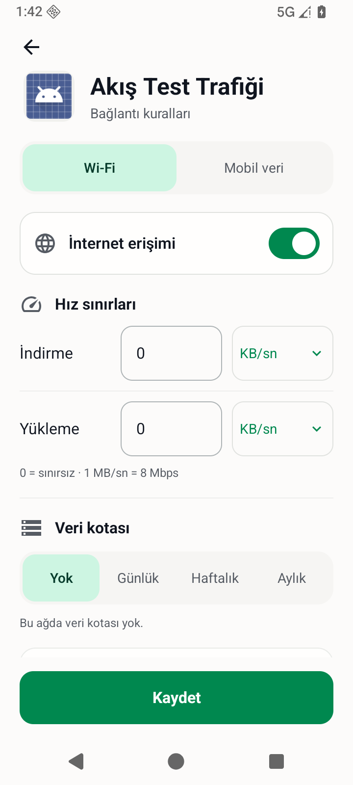

# 11 Kasım 2026 — mint arayüzünün cihaz doğrulaması

Bu kayıt bu oturumda erişilen görünür kullanıcı/asistan yazışmalarını kapsar; otomatik ortam/sayfa meta verileri, araç talimatları ve gizli bilgiler dahil değildir. Mesajların kesin saatleri görünmediği için saat uydurulmadı. Önceki bölüm: [10 Kasım ikinci oturum](2026-11-10-setup-followup.md).

## 1 — Kullanıcı

devam

## 2 — Asistan

Önce GitHub’daki son kayıtları ve yarım kalan cihaz testinin sonucunu kontrol edeceğim. Diğer Codex’in değişikliklerini koruyarak mint tasarımın kalan kontrollerini tamamlayıp her sonucu hemen GitHub’a kaydedeceğim.

## 3 — Asistan

Son test de aynı noktada durmuş, ancak bu kez hata anındaki ekran ağacı kaydedilmiş. Kayıtta mobil alanın yeni değeriyle Wi-Fi sekmesinin eski bilgileri birlikte görünüyor. Testin eski erişilebilirlik verisi okuması ihtimalini inceliyorum; değer ve kaydetme kontrollerini kaldırmadan bunu doğrulayacağım.

## 4 — Asistan

Test kütüphanesinin bu Android sürümünde erişilebilirlik önbelleğini yenilemediğini doğruladım. Android’in desteklenen önbellek yenileme çağrısını test sorgularına ekliyorum; bütün değer, taslak koruma ve kaydetme kontrolleri korunacak.

## 5 — Asistan

Önbellek düzeltmesi derleme ve lint kontrolünden geçti, GitHub’a gönderildi. Cihaz testi şimdi yeni sorgu yöntemiyle çalışıyor. Ardından açık tema ekranlarını ve klavye açıkken düzenleme alanının kullanılabilirliğini kontrol edeceğim.

## 6 — Asistan

Arayüz testi geçti. İki ağın ayrı değerleri, ekran yeniden oluşturulunca taslakların korunması, kaydetme, geçersiz girişin reddi ve listeye dönünce aramanın korunması doğrulandı. Başarı kaydını hemen GitHub’a ekliyorum; kalan iş açık tema ve dar ekran görüntülerini kontrol etmek.

## 7 — Asistan

Açık temayı uygulamanın kendi ayarından seçtim. Son görüntüleri standart telefon genişliğinde alıyorum; ekrandaki uygulama adları ve sayaçlar emülatörün gerçek verileri olacak. Ardından kısa/yatay ekranda klavyeyle düzenlemeyi kontrol edeceğim.

## 8 — Asistanın incelediği gerçek ekran

Bu görüntü 360×800 dp emülatördeki gerçek uygulamadır; önceki tasarım referansı veya yeni üretilmiş bir maket değildir.

## 9 — Asistanın incelediği gerçek ekran

360×800 dp emülatörde gerçek uygulama; kaydetme veya örnek değer ekleme yapılmadan görüntülendi.

## 10 — Asistan

Açık temadaki liste ve kural düzenleme ekranları hazır. Cihazda kaydetme, ayrı Wi-Fi/mobil değerleri ve taslakların korunması da doğrulandı. Son olarak yatay ekranda klavye açıkken formun kullanılabilirliğini kontrol edip görüntüleri GitHub’a ekliyorum.
