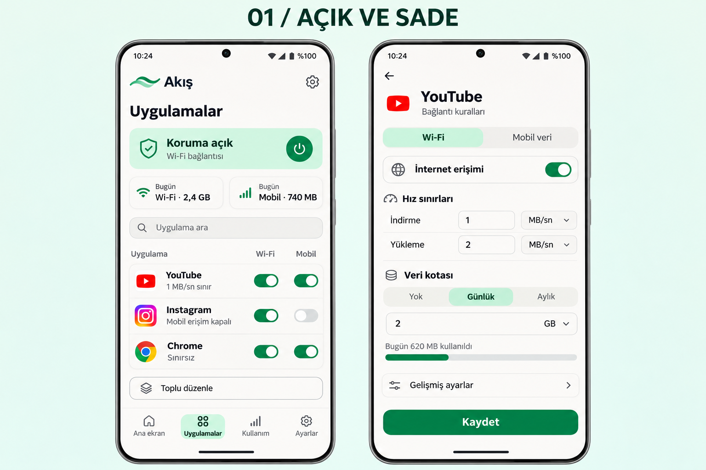
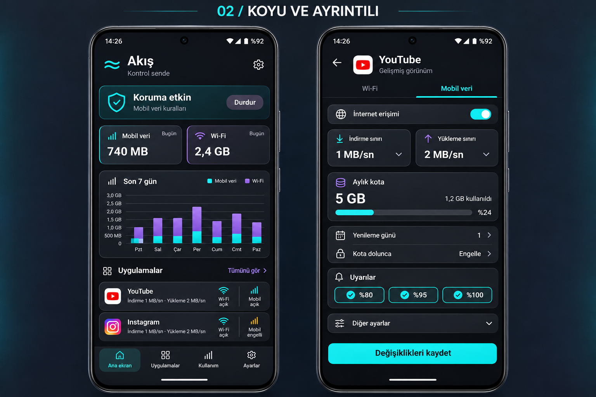
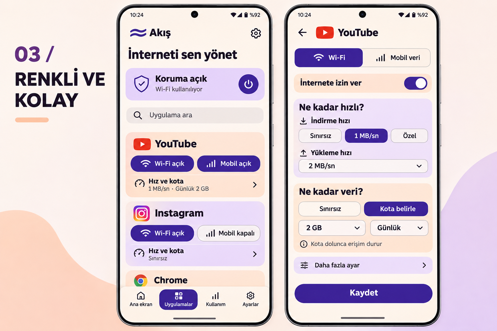

# Akış tasarım seçenekleri

9 Kasım 2026 tarihinde kullanıcıya sunulan üç görsel konsept. Her görsel iki ekran içerir. Bunlar uygulamaya henüz aktarılmadı; kullanıcı seçimi bekleniyor. APK 0.1.3 değişmedi.

| Seçenek | Ekranlar ve yaklaşım |
| --- | --- |
| [1 — Açık ve sade](01-acik-ve-sade.png) | Açık mint tonlarında uygulama listesi ve kural düzenleyici; sade, okunur kontroller. |
| [2 — Koyu ve ayrıntılı](02-koyu-ve-ayrintili.png) | Grafit/camgöbeği kontrol paneli ve gelişmiş kural düzenleyici; daha yoğun bilgi görünümü. |
| [3 — Renkli ve kolay](03-renkli-ve-kolay.png) | Krem/menekşe tonlarında büyük kartlar ve basit düzenleyici; kolay taranabilen seçenekler. |

## 1 — Açık ve sade

## 2 — Koyu ve ayrıntılı

## 3 — Renkli ve kolay

Seçim veya revizyon isteği geldiğinde önce [devir kaydını](../HANDOFF.md) ve uzak depo durumunu kontrol et. Görsellerdeki örnek sayılar test sonucu veya yeni özellik taahhüdü değildir.
